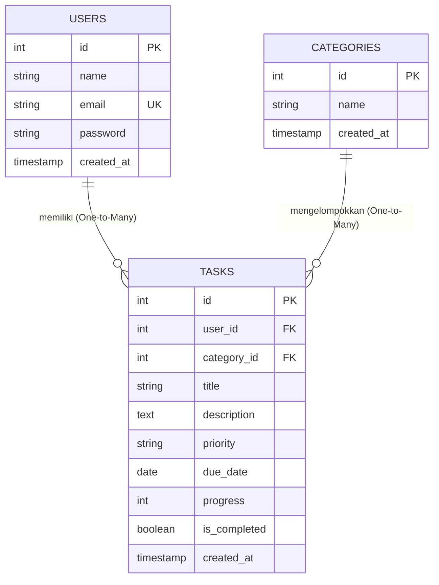

# Daftar Lengkap Function & Struktur Database Aplikasi To-Do List UKK

> Dokumen ini memuat seluruh daftar **Function (Fungsi Logika Backend & Frontend)** serta **Struktur Tabel Database (SQLite)** yang digunakan pada aplikasi To-Do List untuk persiapan Uji Kompetensi Keahlian (UKK) RPL/PPLG.

---

## DAFTAR ISI
1. [Bagian 1: Daftar Seluruh Function (Fungsi Kodingan)](#bagian-1-daftar-seluruh-function)
   - [A. Backend: AuthController (Pengatur Otentikasi & Akun)](#a-backend-authcontroller-pengatur-otentikasi--akun)
   - [B. Backend: TaskController (Pengatur Data Tugas)](#b-backend-taskcontroller-pengatur-data-tugas)
   - [C. Frontend: JavaScript Interaktif (Browser/Layar)](#c-frontend-javascript-interaktif-browserlayar)
2. [Bagian 2: Struktur Tabel Database (SQLite)](#bagian-2-struktur-tabel-database-sqlite)
   - [A. Tabel Utama Aplikasi (users, categories, tasks)](#a-tabel-utama-aplikasi)
   - [B. Tabel Pendukung Sistem Laravel](#b-tabel-pendukung-sistem-laravel)
3. [Bagian 3: Diagram Hubungan / Relasi Antar Tabel (ERD)](#bagian-3-diagram-hubungan--relasi-antar-tabel-erd)
4. [Bagian 4: Tanya-Jawab Cepat dengan Penguji Terkait Database & Function](#bagian-4-tanya-jawab-cepat-dengan-penguji)

---

# Bagian 1: Daftar Seluruh Function

Aplikasi ini membagi logika kode menjadi dua layer: **Backend (Controller Laravel)** dan **Frontend (JavaScript DOM & AJAX)**.

```
Pengguna di Layar (Frontend)
   │
   ├── JavaScript Event (setTaskProgress, onSliderCommit, openEditModal)
   │
   ▼ [HTTP Request: GET / POST / PUT / PATCH / DELETE]
Rute Laravel (routes/web.php)
   │
   ▼
Backend Controller (AuthController / TaskController)
   │
   ▼ [Query Eloquent ORM]
Database SQLite (users, categories, tasks)
```

---

### A. Backend: `AuthController` (Pengatur Otentikasi & Akun)
*Berkas:* `app/Http/Controllers/AuthController.php`

| Nama Function | Tipe HTTP & Rute | Fungsi dan Penjelasan Logika |
| :--- | :--- | :--- |
| **`showLoginForm()`** | `GET /login` | Menampilkan halaman formulir login (`auth.login`) kepada pengunjung yang belum masuk. |
| **`login(Request $request)`** | `POST /login` | Memvalidasi kelengkapan email & password, mencocokkan kredensial dengan database via `Auth::attempt()`, me-regenerasi session ID untuk mencegah *Session Fixation*, dan mengarahkan pengguna ke halaman daftar tugas. |
| **`showRegisterForm()`** | `GET /register` | Menampilkan formulir pendaftaran akun baru (`auth.register`). |
| **`register(Request $request)`** | `POST /register` | Memvalidasi input (nama, email unik, minimal password 6 karakter), mengenkripsi kata sandi menggunakan hashing aman (`Hash::make()`), menyimpannya ke tabel `users`, dan langsung memasukkan user ke sesi aktif (*auto-login*). |
| **`logout(Request $request)`** | `POST /logout` | Mengeluarkan pengguna dari sistem dengan memanggil `Auth::logout()`, menghapus seluruh data sesi (`invalidate()`), me-regenerasi token keamanan CSRF (`regenerateToken()`), dan mengarahkan kembali ke halaman login. |

---

### B. Backend: `TaskController` (Pengatur Data Tugas)
*Berkas:* `app/Http/Controllers/TaskController.php`

| Nama Function | Tipe HTTP & Rute | Fungsi dan Penjelasan Logika |
| :--- | :--- | :--- |
| **`index(Request $request)`** | `GET /` | Mengambil seluruh tugas milik user aktif (`auth()->user()->tasks()`), memuat relasi kategori (*Eager Loading* `with('category')` untuk menghindari *N+1 Query Problem*), menjalankan filter pencarian teks (*search*), filter status (*completed/pending*), filter kategori, dan menghitung ringkasan statistik tugas. |
| **`store(Request $request)`** | `POST /tasks` | Memvalidasi data input formulir tambah tugas (judul wajib max 255 huruf, kategori wajib ada di database, prioritas low/medium/high, batas waktu format tanggal), lalu menyimpannya langsung terhubung ke ID user aktif: `auth()->user()->tasks()->create(...)`. |
| **`toggle($id)`** | `PATCH /tasks/{id}/toggle` | Membalik status centang tugas secara instan. Jika sebelumnya belum selesai, diubah jadi selesai dan progres otomatis diisi 100%. Jika sebelumnya selesai, diubah jadi belum selesai dan progres di-reset ke 0%. |
| **`update(Request $request, $id)`** | `PUT /tasks/{id}` | Menerima data perubahan dari pop-up modal Edit Tugas untuk memperbarui judul, kategori, prioritas, tenggat waktu, progres, dan deskripsi pada tugas spesifik milik user aktif. |
| **`updateProgress(Request $request, $id)`** | `PATCH /tasks/{id}/progress` | Endpoint khusus API asinkron (AJAX Fetch). Menerima angka progres slider (0 s.d. 100%) dan menyimpannya ke database secara *realtime*. Jika slider ditarik mentok kanan (100%), status `is_completed` otomatis diubah menjadi `true`. Mengembalikan respon JSON `{ success: true }`. |
| **`destroy($id)`** | `DELETE /tasks/{id}` | Menghapus satu baris tugas dari database secara permanen. Dilindungi dengan kepemilikan user aktif (`auth()->user()->tasks()->findOrFail($id)`) sehingga mustahil pengguna A menghapus tugas pengguna B (*Anti-IDOR*). |

---

### C. Frontend: JavaScript Interaktif (Browser/Layar)
*Berkas:* `resources/views/tasks/index.blade.php`

| Nama Function | Pemicu (Trigger) | Peran dan Fungsinya di Layar |
| :--- | :--- | :--- |
| **`setTaskProgress(taskId, value)`** | Klik tombol cepat (*25%*, *50%*, *75%*, *100%*) | Mengubah posisi slider secara instan ke angka yang dipilih, lalu otomatis memicu fungsi visual dan fungsi kirim data ke server. |
| **`updateBulletButtons(taskId, val)`** | Perubahan angka slider | Mengubah highlight warna tombol preset angka agar tombol yang sesuai dengan angka saat ini menyala aktif. |
| **`onSliderLiveChange(taskId, value)`** | Geser slider (Event `input`) | Memberikan umpan balik visual seketika pada layar: mengubah teks label progres (misal: "✓ Selesai"), mengubah warna jempol slider, dan menandai kartu selesai jika mencapai 100%. |
| **`onSliderCommit(taskId, value)`** | Lepas slider (Event `change`) | Mengirimkan request AJAX ke backend via `fetch('/tasks/{id}/progress')` bermetode `PATCH` dengan membawa CSRF Token dan data JSON `{ progress: value }`. Dilengkapi penanganan error jaringan `if (!response.ok)`. |
| **`recalculateCounters()`** | Setelah progres tersimpan | Menghitung ulang total tugas selesai dan tugas tertunda pada kotak ringkasan atas secara instan di peramban tanpa me-refresh halaman. |
| **`openEditModal(task)`** | Klik ikon pensil (Ubah Tugas) | Membuka jendela pop-up modal dan otomatis mengisi semua kotak input form dengan data lama tugas yang dipilih. |
| **`closeEditModal()`** | Klik tombol "Batal" atau area luar | Menutup jendela pop-up modal edit tugas. |

---

# Bagian 2: Struktur Tabel Database (SQLite)

Database menggunakan SQLite yang disimpan dalam berkas tunggal `database/database.sqlite`. Terdapat **3 tabel inti aplikasi** dan tabel pendukung bawaan framework Laravel.

---

### A. Tabel Utama Aplikasi

#### 1. Tabel `users` (Menyimpan Akun Pengguna)
*Berkas Migrasi:* `database/migrations/0001_01_01_000000_create_users_table.php`

| Kolom | Tipe Data | Constraint / Aturan | Keterangan & Fungsi |
| :--- | :--- | :--- | :--- |
| **`id`** | INTEGER | PRIMARY KEY, AUTOINCREMENT | Nomor identitas unik setiap akun pengguna. |
| **`name`** | VARCHAR(255) | NOT NULL | Nama lengkap pengguna untuk sapaan di dashboard. |
| **`email`** | VARCHAR(255) | UNIQUE, NOT NULL | Alamat surel unik yang digunakan sebagai username login. |
| **`password`** | VARCHAR(255) | NOT NULL | Kata sandi yang sudah diacak/diamankan (*Bcrypt Hash*). |
| **`remember_token`** | VARCHAR(100) | NULLABLE | Token penyimpanan otomatis login (*Remember Me*). |
| **`created_at`** | TIMESTAMP | NULLABLE | Waktu dan tanggal saat akun pertama kali didaftarkan. |
| **`updated_at`** | TIMESTAMP | NULLABLE | Waktu dan tanggal saat data akun terakhir kali diubah. |

---

#### 2. Tabel `categories` (Master Kategori Tugas)
*Berkas Migrasi:* `database/migrations/2024_01_01_000001_create_categories_table.php`

| Kolom | Tipe Data | Constraint / Aturan | Keterangan & Fungsi |
| :--- | :--- | :--- | :--- |
| **`id`** | INTEGER | PRIMARY KEY, AUTOINCREMENT | Nomor identitas unik setiap kategori. |
| **`name`** | VARCHAR(255) | NOT NULL | Nama label pengelompokan (Contoh: *Sekolah*, *Pribadi*, *Pekerjaan*). |
| **`created_at`** | TIMESTAMP | NULLABLE | Waktu pembuatan data kategori. |
| **`updated_at`** | TIMESTAMP | NULLABLE | Waktu pembaruan data kategori. |

---

#### 3. Tabel `tasks` (Daftar Tugas / To-Do List)
*Berkas Migrasi:* `database/migrations/2024_01_01_000002_create_tasks_table.php`

| Kolom | Tipe Data | Constraint / Aturan | Keterangan & Fungsi |
| :--- | :--- | :--- | :--- |
| **`id`** | INTEGER | PRIMARY KEY, AUTOINCREMENT | Nomor identitas unik setiap tugas. |
| **`user_id`** | INTEGER | FOREIGN KEY $\rightarrow$ `users(id)`, ON DELETE CASCADE | Menghubungkan tugas ke pemiliknya. Jika akun user dihapus, semua tugas miliknya terhapus otomatis. |
| **`category_id`** | INTEGER | FOREIGN KEY $\rightarrow$ `categories(id)`, ON DELETE CASCADE | Menghubungkan tugas ke data master kategori. |
| **`title`** | VARCHAR(255) | NOT NULL | Judul atau nama tugas yang wajib diisi pengguna. |
| **`description`** | TEXT | NULLABLE | Catatan rincian atau keterangan tugas (boleh kosong). |
| **`priority`** | VARCHAR / ENUM | DEFAULT 'medium' | Tingkat urgensi tugas: `'low'`, `'medium'`, atau `'high'`. |
| **`due_date`** | DATE | NULLABLE | Batas akhir pengerjaan tugas format kalender `YYYY-MM-DD`. |
| **`progress`** | UNSIGNED TINYINT| DEFAULT 0, RENTANG 0-100 | Angka persentase penyelesaian tugas (0% s.d. 100%). |
| **`is_completed`**| BOOLEAN | DEFAULT 0 (false) | Status penyelesaian: `0` (Belum Selesai), `1` (Selesai). |
| **`created_at`** | TIMESTAMP | NULLABLE | Waktu pencatatan tugas. |
| **`updated_at`** | TIMESTAMP | NULLABLE | Waktu tugas terakhir kali diedit atau diubah statusnya. |

---

### B. Tabel Pendukung Sistem Laravel

Tabel-tabel ini dibuat otomatis oleh Laravel untuk menopang infrastruktur aplikasi:
1. **`sessions`:** Menyimpan status login aktif pengguna peramban (ID sesi, IP Address, User Agent, dan masa aktif).
2. **`password_reset_tokens`:** Menyimpan token acak saat ada permintaan ubah kata sandi melalui email.
3. **`migrations`:** Buku jurnal catatan file migrasi apa saja yang sudah berhasil dieksekusi ke database.
4. **`cache` & `cache_locks`:** Digunakan jika aplikasi mengaktifkan penyimpanan data sementara (*caching*) untuk mempercepat performa.

---

# Bagian 3: Diagram Hubungan / Relasi Antar Tabel (ERD)



### Penjelasan Relasi dalam Bahasa Sehari-hari:
* **Relasi Pengguna ke Tugas (*One-to-Many*):**  
  Satu akun pengguna (`users`) dapat mencatat banyak tugas (`tasks`), tetapi satu tugas hanya bisa dimiliki oleh satu pengguna tertentu.
* **Relasi Kategori ke Tugas (*One-to-Many*):**  
  Satu kategori (`categories`), misalnya *"Sekolah"*, bisa dipakai oleh banyak tugas berbeda.
* **Integritas Penghapusan (*Cascade Delete*):**  
  Jika sebuah akun pengguna dihapus dari database, seluruh data tugas yang pernah dibuat oleh akun tersebut akan otomatis ikut terhapus bersih, sehingga tidak meninggalkan data sampah tak bertuan (*orphan records*).

---

# Bagian 4: Tanya-Jawab Cepat dengan Penguji

### 1. "Mengapa menggunakan metode HTTP PATCH untuk fungsi toggle dan updateProgress, bukan POST atau PUT?"
> **Jawaban:**  
> Sesuai standar RESTful API, metode **PUT** digunakan jika kita ingin mengganti atau menimpa **seluruh kolom data**. Sedangkan metode **PATCH** khusus digunakan saat kita hanya ingin memperbarui **sebagian kecil atribut saja** (seperti hanya mengubah status centang atau hanya menggeser angka progres).

### 2. "Apa fungsi relasi `foreignId('user_id')->constrained()->onDelete('cascade')` pada tabel tasks?"
> **Jawaban:**  
> Fungsi utamanya adalah menjaga integritas referensial data. `foreignId` memastikan tugas selalu terikat ke akun pengguna yang valid, dan `onDelete('cascade')` menjamin jika data pengguna dihapus, semua tugas miliknya terhapus otomatis dari database tanpa menyisakan data yatim (*orphan data*).

### 3. "Bagaimana aplikasi menjamin pengguna A tidak bisa melihat atau mengedit tugas pengguna B?"
> **Jawaban:**  
> Kami menerapkan proteksi *Anti-IDOR (Insecure Direct Object References)* di `TaskController`. Setiap query pengambilan, pengubahan, maupun penghapusan data selalu diikat melalui relasi user yang sedang login: `auth()->user()->tasks()`, bukan sekadar memanggil `Task::find($id)`.

### 4. "Kenapa menggunakan SQLite bukan MySQL untuk ujian ini?"
> **Jawaban:**  
> SQLite bekerja secara mandiri (*serverless*) berbasis satu file di dalam proyek (`database.sqlite`). Hal ini membuat aplikasi sangat ringan, cepat, portabel, tidak membutuhkan servis server MySQL terpisah, dan tidak rentan gagal koneksi saat demo ujian offline.
